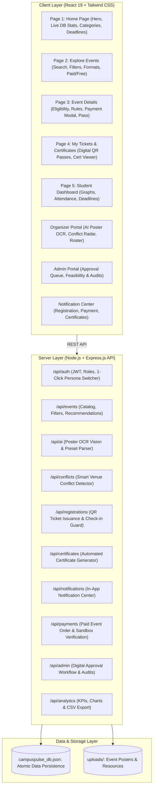

# SRM CampusPulse — Smart Campus Event Hub

> **“Discover. Participate. Achieve.”**  
> *Your campus events, all in one place.*  
> **Proposed Campus Platform Prototype for SRM Institute of Science and Technology, Ramapuram Campus**

[](http://localhost:5173)
[](http://localhost:5173)
[](http://localhost:5173)
[](http://localhost:5000)
[]()
[]()

---

## 📌 Project Overview
**SRM CampusPulse** is a university-style event registration and organization platform designed for the SRM campus community (initially focused on **SRM Institute of Science and Technology, Ramapuram**).

It centralizes event discovery, registration, event creation, administrative approvals, venue scheduling, digital tickets, QR-based attendance, certificates, resource sharing, payments for paid events, and platform analytics.

> **Academic & Prototype Disclosure**: This platform is an independent student innovation proposal and technology prototype designed for live hackathon demonstration. It is not officially operated, approved, or endorsed by SRM Institute of Science and Technology.

---

## 🏛️ System Architecture



---

## 👥 Three Dedicated Roles & Personas

CampusPulse features a **built-in Persona Switcher bar** at the top of the interface:

| Persona | Role | Department / Title | Primary Demo Workflow |
| :--- | :--- | :--- | :--- |
| **Alex Rivera** | `Student` | CSE, 3rd Year (RA2211003020042) | Discover events, view 98% AI Match, claim QR ticket, download `.ics` calendar pass, view certificates. |
| **Kaviya Sundaram** | `Student` | IT, 2nd Year (RA2311004010119) | Register for paid/cultural events, view certificates, test duplicate gate check-in. |
| **Prof. Arun Karthik** | `Organizer` | Faculty Coordinator, SRM Coding Club | Launch AI Poster Studio, observe venue conflict warnings, open QR Scanner desk, export CSV roster. |
| **Swetha Raman** | `Organizer` | Student Convener, Cultural Council | Host cultural fests, manage participant limits, view attendance rates. |
| **Dr. M. Murali Krishna**| `Admin` | Dean of Student Affairs | Review pending approval queue, inspect venue conflict status, approve/reject with audit log. |

---

## 🌟 Comprehensive Portals & Pages

### 1. Student Portal (5 Pages)

#### Page 1: Home Page
- **Hero Section**: “Discover. Participate. Achieve.” — *Your campus events, all in one place.*
- **Action CTAs**: Explore All Events, Host an Event (role-governed), Go to Student Dashboard.
- **Genuine Calculated Database Statistics**: Real-time counts of approved events, student registrations, active SRM clubs, and audited campus venues.
- **Spotlight Featured Event**: Highlighted major campus initiative with registration status.
- **Popular Campus Categories**: Technical, Hackathon, Workshop, Sports, Cultural, Literary, Awareness Rally, NSS & Volunteering, Music, Dance & Drama, Seminar & Conference.
- **Registration Deadlines Reminders**: Visual countdown cards for upcoming registration closures.

#### Page 2: Explore Events
- **Search Engine**: Search by title, organizer club, venue, or keywords.
- **Multi-Parameter Filter Matrix**:
  - *Category*: Technical, Hackathon, Workshop, Sports, Cultural, etc.
  - *Venue*: TRP Auditorium, Dr. T. P. Ganesan Mini Hall 1, Tech Park Lab, etc.
  - *Format*: In-Person (On-Campus) vs. Online / Hybrid.
  - *Fee*: Free Events Only vs. Paid Events Only.
  - *Availability*: Seats Open vs. Capacity Reached (Sold Out).
- **Sort Options**: Upcoming Date, Personalized Match Score, Most Popular, Recently Published.
- **Pagination / Load More**: Responsive event grid with load-more pagination.

#### Page 3: Event Details & Registration
- Detailed overview: title, high-res poster, organizing club, faculty coordinator, date & timings, venue, capacity progress meter, eligibility criteria, prerequisites, official participation rules, downloadable resources, and organizer helpdesk contacts.
- **Registration Pipeline**:
  - Checks eligibility, deadlines, and seat capacity.
  - Prevents duplicate registrations.
  - If event is paid (e.g. ₹150 for Milan Cultural Fiesta or ₹100 for AWS Workshop), triggers the **Secure Payment Gateway Modal** (sandbox test checkout simulating card/UPI verification).
  - Confirms registration, fires celebratory confetti, and opens the **Digital QR Pass**.

#### Page 4: My Tickets and Certificates
- **Digital Passes Tab**: Filter by Upcoming Active, Attended / Completed, and Cancelled.
  - Shows ticket token hash, event date, venue, seat allocation, payment status.
  - **View Official QR Pass**: Digital boarding pass with scannable QR code and `.ics` calendar export.
  - **Cancel Registration**: Frees up the seat if allowed.
- **Earned Certificates Tab**:
  - Displays verified credentials issued upon attendance check-in.
  - **Certificate Modal**: University certificate of participation with Student Name, Registration Number, Event Title, Date, Certificate Number, Verification Hash, and Print/Download buttons!

#### Page 5: Student Dashboard
- Profile summary card with student registration number, department, academic year, and campus.
- Metric KPI cards: Total Registered, Upcoming Events, Attended Events, Certificates Earned.
- **Monthly Participation Graph**: Recharts Area Chart displaying participation velocity.
- **Category Participation Breakdown**: Recharts Donut Chart.
- Top recommended events and recent campus announcements.

---

### 2. Organizer Portal (4 Pages)
1. **Create Event & AI Poster Studio**:
   - Structured event creation form with all required fields (title, category, poster upload, club, faculty coordinator, date, start/end time, venue, capacity, fee, eligibility, guidelines, resources, cancellation policy).
   - **AI Poster Extraction**: Upload any poster image or click sample templates (*HackAI*, *SoundWave*, *AeroStrike*) for instant OCR extraction with confidence scores!
   - Defaults to *Pending Approval*.
2. **Event Management**:
   - Tabs: *Approved Events* vs. *Pending Events*.
   - Live registration counts vs. room capacities.
   - Edit draft, submit for approval, track review status.
   - **Smart Venue Conflict Detection**: Real-time overlap warning with 1-click alternative time slot & venue suggestions.
3. **QR Check-in and Attendance Desk**:
   - Event selector, live webcam QR scanner (`html5-qrcode`), and instant test buttons (*Test Valid Ticket*, *Test Duplicate Ticket*).
   - **Anti-Duplicate Check-in Guard**: Flags tickets already scanned with exact timestamp and staff name.
   - Searchable participant list with check-in timestamps and CSV export.
4. **Events and Analytics**:
   - Total events, approved, pending, completed, total registrations, paid revenue, attendance rate.
   - Graphs: Event-wise registrations, attendance rate, monthly activity.
   - Export attendee roster to `.CSV`.

---

### 3. Administrator / Higher-Authority Portal (4 Pages)
1. **Approval Management**:
   - Pending event queue with full proposal details and uploaded posters.
   - Real-time venue feasibility and collision checks.
   - **Approve Event** with clearance notes.
   - **Reject Event** with formal categorized reasons (*"Venue booked for convocation"*, *"Curfew violation"*, *"Safety equipment missing"*) and corrective advice.
   - Complete approval history audit trail.
2. **Venue and Schedule Management**:
   - Campus venues catalog (TRP Auditorium, Dr. T. P. Ganesan Mini Hall 1, Tech Park Lab, Mechanical Seminar Hall, Central Library AV Hall, Indoor Sports Complex, Open Amphitheatre).
   - Facilities inspection, capacity review, and availability status.
3. **User & Club Management**:
   - Account directory, club coordinators, and privilege assignments.
4. **Platform Analytics**:
   - Comprehensive university event intelligence, capacity utilization, and downloadable reports.

---

### 4. Notifications & Resource Sharing
- **Notification Center**: Bell icon with live unread badge.
  - Alerts for registration confirmations, payment receipts, venue changes, certificate issuance, and admin approvals.
  - Filter by All vs. Unread with "Mark all read" action.
- **Resource Attachments**: Organizers can attach rulebooks, problem statements, starter code, and presentation slides for students to download.

---

### 5. Payment Management
- Support for both free and paid events in Indian Rupees (**INR ₹**).
- Test sandbox payment gateway modal supporting simulated UPI and Card checkout.
- Server-side transaction reference generation (`TXN_SRM_...`).
- Stored safely in database with zero card numbers retained.

---

## ⚡ Quick Start & Execution

```bash
# Navigate to the project directory
cd C:\Users\Ruthwik\OneDrive\Desktop\CampusPulse

# Double-click the desktop launcher, or run:
npm start
```

- **Frontend Application**: **[http://localhost:5173](http://localhost:5173)**
- **Backend API**: **[http://localhost:5000/api/health](http://localhost:5000/api/health)**
- **Desktop One-Click Shortcut**: Double-click [`CampusPulse.url`](file:///C:/Users/Ruthwik/OneDrive/Desktop/CampusPulse.url) or [`Run_CampusPulse.bat`](file:///C:/Users/Ruthwik/OneDrive/Desktop/Run_CampusPulse.bat) on your Desktop anytime.

---

## 🎯 Step-by-Step Hackathon Demonstration Script

### Act 1: Student Discovery & Registration
1. Open **[http://localhost:5173](http://localhost:5173)**. You are logged in as **Alex Rivera** (CSE Student).
2. Explore the **Home Page**: Observe the hero section, the calculated database statistics (Approved Events, Student Registrations, Active SRM Clubs), categories, and deadlines.
3. Click **"Explore Events"**: Filter by category (*Hackathon*) or format (*In-Person*).
4. Click **"View Details & Register"** on **SRM HackMatrix 2026**:
   - Inspect eligibility, rules, and downloadable resources.
   - Click **"Confirm Free Registration"**. Enjoy the **confetti animation**!
   - Review your **Digital QR Boarding Pass** with seat assignment (`Seat A-14`).
   - Click **"Add to Calendar (.ics)"** to download the calendar invite.
5. In the top nav, click **"My Tickets & Certificates"**: View your confirmed pass under *Upcoming Active*.

### Act 2: Paid Event Registration (Sandbox Payment)
1. Go to **"Explore Events"** and click **Milan Cultural Fiesta** (Fee: ₹150).
2. Click **"Pay ₹150 & Register"**:
   - The **Secure Payment Gateway Sandbox** modal opens.
   - Enter/review your UPI ID and click **"Authorize & Pay ₹150"**.
   - Transaction reference `TXN_SRM_...` is verified server-side.
   - Digital pass is generated with `PAID` status!

### Act 3: Organizer AI Poster Studio & Venue Conflict Radar
1. In the top bar, switch to **Prof. Arun Karthik (Org)**.
2. Click **"Organizer Portal"** -> **"Launch AI Poster Studio"**.
3. Under *Demo Posters*, click **"HackAI 2026 Poster"**.
   - The AI OCR engine extracts Title, Date, Timing, Venue, and Description with confidence metrics.
4. In the venue selector, pick **"Tech Park Innovation Lab"** on date `2026-10-24`:
   - The **Smart Venue Conflict Radar** immediately warns:
     > *“Schedule conflict detected! 1 overlapping event(s) booked at Tech Park Innovation Lab.”*
   - Click **"Switch to Dr. T. P. Ganesan Mini Hall 1"**.
   - The conflict banner turns green: *“Venue Clear: No scheduling overlaps detected.”*
5. Click **"Submit for College Administration Approval"**.

### Act 4: Administrative Approval & Audit Trail
1. Switch to **Dr. M. Murali Krishna (Dean / Admin)**.
2. Click **"Dean Review"**:
   - Locate the submitted proposal with the real-time venue feasibility badge.
   - Click **"Approve Request"**, add dean clearance notes, and confirm.
   - Open **"Audit Trail"** to verify the chronological decision log.

### Act 5: Event Staff QR Check-In & Anti-Duplicate Guard
1. Switch back to **Prof. Arun Karthik (Org)** and click **"QR Scanner Desk"**.
2. **Valid Ticket Test**: Click the shortcut *"Test Valid Ticket (Alex Rivera)"*:
   - ✅ Green Alert: *“Entry Verified! Welcome, Alex Rivera. Attendance recorded.”*
   - Notice that a **verified Certificate of Attendance is automatically issued** to Alex!
3. **Duplicate Prevention Test**: Click *"Test Duplicate Ticket (Already Scanned)"*:
   - ⚠️ Amber Alert: *“ALREADY CHECKED IN! This ticket was verified earlier by Gate Staff. Prevent duplicate entry!”*
4. **Counterfeit Test**: Click *"Test Invalid Token"*:
   - ❌ Red Alert: *“Counterfeit or Unrecognized Ticket! Access denied.”*

### Act 6: Certificate Verification & Student Dashboard
1. Switch back to **Alex Rivera (Student)**.
2. Click **"My Tickets & Certificates"** -> **"Earned Certificates"**:
   - View your new certificate: **"SRM Cloud Native DevOps Bootcamp"**.
   - Click **"View & Download Certificate"**: Inspect the certificate with student registration number, verification hash, and authorized signatures.
3. Click **"Student Dashboard"**: View the monthly participation curve, category donut chart, and attendance count!

---

## 🔒 Security & Data Integrity
- **Role-Based Protection**: Privileged administrative functions (event approvals, role assignments) are strictly enforced.
- **Anti-Duplicate QR Security**: Non-guessable cryptographic tokens prevent counterfeiting and duplicate check-in fraud.
- **No Stored Financial Credentials**: Payment simulation operates strictly with transaction references; no card numbers or CVVs are retained.
- **Atomic File Persistence**: Server database writes are isolated and atomic, with instantaneous 1-click demo resets.

---

## 📜 License
Developed as an academic technology platform prototype for university hackathon demonstration. Licensed under the MIT License.
